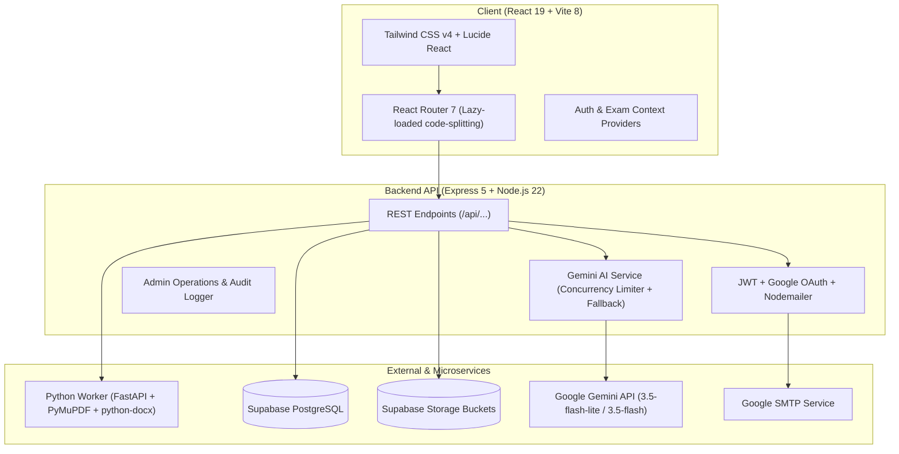

# ⚡ ExamForge

> **Next-Generation AI Study & Exam Platform:** Transform textbooks, lecture slides, audio/video recordings, and course syllabi into verified exam papers, intelligent preparation schedules, and interactive lecture intelligence.

---

## 🌟 Overview

**ExamForge** is a full-stack, AI-native academic platform built for students, educators, and institutions. Upload study materials (PDF, DOCX) or lecture recordings (MP3, MP4, WAV, M4A), and ExamForge uses high-throughput Google Gemini models and modern vector pipelines to:

1. **Synthesize Balanced Exam Papers** with verified source citations, detailed explanations, and marking schemes.
2. **Generate AI Study Schedules & Exam Timetables** mapped intelligently across multiple courses, exams, and test series.
3. **Analyze Lecture Recordings** with timestamped transcripts, conceptual summaries, and interactive timestamp-linked AI Q&A.
4. **Empower Administrators** via a dedicated, secure management portal (`/boss`) with real-time platform telemetry and user management.

---

## 🚀 Key Features

### 1. 📝 AI Exam Generator (`/work`)
- **Multi-Format Document Ingestion:** High-speed text and structure extraction from `.pdf` and `.docx` materials using PyMuPDF and `python-docx`.
- **Proportional Question Allocation:** Upload multiple modules or chapters; questions are balanced across documents using the *Largest Remainder Method*.
- **Comprehensive Question Formats:**
  - **Multiple Choice Questions (MCQs):** 4 distinct options with unambiguous correct answers and detailed rationales.
  - **Short Answer:** 1–3 sentence focused responses with essential key terms.
  - **Long Answer / Essay:** Multi-point structured responses, grading criteria, and deep concept synthesis.
- **Verified Page Citations:** Every question includes exact source page numbers from your uploaded material.
- **Context-Aware AI Tutor:** Chat directly with an AI tutor on any specific question for clarifications, alternative examples, or step-by-step solutions.
- **Export & Print Ready:** Instant one-click Markdown clipboard copy and print stylesheets for clean paper formatting.

---

### 2. 📅 AI Study Planner & Exam Scheduler (`/study-planner`)
- **Multi-Document Syllabus Mapping:** Upload course notes, textbooks, and past papers; AI automatically matches topics against your exam syllabus.
- **Gap & Overlap Detection:** Flags missing syllabus topics not covered in your uploaded resources and identifies shared concepts across multiple exams.
- **Intelligent Preparation Ordering:** Analyzes topic dependencies (e.g., prerequisite concepts before advanced topics), topic difficulty, and exam dates.
- **Personalized Timetables:** Distributes study sessions, active recall tasks, revision rounds, and mock exam milestones based on daily available study hours.
- **Multi-Exam & Test Series Support:** Manage concurrent preparation schedules for Quizzes, Midterms, and Finals simultaneously.

---

### 3. 🎙️ Daily Lecture Intelligence (`/daily-lecture`)
- **Audio & Video Processing:** Supports MP3, WAV, M4A, and MP4 lecture recordings uploaded directly to secure Supabase Storage.
- **Smart Summarization:** Generates executive lecture summaries, key topic breakdowns, and core pedagogical takeaways.
- **Timestamped Citations:** Interactive AI tutor cites exact recording moments (e.g., `[14:20]`), allowing students to jump straight to relevant audio/video segments.
- **One-Click Exam Conversion:** Convert any analyzed lecture directly into an ExamForge practice exam session.

---

### 4. 🛡️ Dedicated Admin Control Panel (`/boss`)
- **Dedicated Admin Authentication:** Separate authentication barrier with bcrypt hashing, isolated session management, and brute-force protection.
- **Real-Time Telemetry:** Live counters and trend charts for registered users, active sessions, exam generations, document uploads, and AI error rates.
- **User Management:** Search, filter, view exam/document history, block/unblock accounts, issue secure password resets, and perform cascade deletions.
- **Content & Storage Oversight:** Inspect generated exams, questions, and uploaded documents; monitor storage footprint and clean up obsolete records.
- **AI Latency & Model Monitoring:** Track Gemini API response latencies, token consumption, and failovers.
- **Platform Controls:** Toggle public registration, configure file size ceilings, manage allowed file types, and broadcast global announcement banners.

---

### 5. 🔐 Authentication & Security
- **Email & Password Authentication:** Secure registration and login powered by JWT tokens stored in HTTP-only cookies.
- **Google OAuth 2.0 Sign-In:** One-click single sign-on with Google accounts.
- **Gmail Password Recovery:** Six-digit OTP verification codes delivered via Google SMTP / Nodemailer.
- **Role-Based Access Control:** Strict segregation between student users and administrators.
- **Enterprise-Grade Sanitization:** Input validation using Zod, parameter sanitization, and SQL injection prevention.

---

## 🏗️ Architecture & Tech Stack



### Technology Highlights
| Layer | Technologies |
| :--- | :--- |
| **Frontend** | React 19, Tailwind CSS v4, Vite 8, React Router 7, Lucide Icons |
| **Backend API** | Node.js 22+, Express 5, `@google/genai` SDK, `@supabase/supabase-js`, Nodemailer, BcryptJS, JWT |
| **Document Worker** | Python 3.10+, FastAPI, PyMuPDF (fitz), python-docx, Uvicorn |
| **Database & Storage** | Supabase (PostgreSQL 15+ with Row-Level Security, Supabase Storage) |
| **AI Generation** | Google Gemini `gemini-3.5-flash-lite` (primary, ~1.8s) & `gemini-3.5-flash` (fallback) |

---

## 📁 Repository Structure

```plaintext
Exam-Fordge/
├── client/                     # Frontend Single Page Application
│   ├── src/
│   │   ├── Admin-Dashboard/    # /boss management portal views & components
│   │   ├── Context/            # React Context (AuthContext, ExamContext)
│   │   ├── Front-Page/         # Landing page & Auth components (Login, Signup, ForgotPassword)
│   │   ├── Lecture-Intelligence/# Daily lecture recording analysis & Q&A
│   │   ├── Study-Planner/      # Study schedule, timetable, and syllabus mapping
│   │   ├── working-pages/      # Exam generation, upload interface, history
│   │   └── App.jsx             # Route definitions with lazy code-splitting
│   ├── package.json
│   └── vite.config.js
│
├── server/                     # Backend API Server
│   ├── Api/                    # Express app setup and main server entry (Index.js)
│   ├── config/                 # Environment validation and Redis configuration
│   ├── controllers/            # Route controllers (exam, user, admin, lecture, study planner)
│   ├── middleware/             # Auth guards, role checks, rate limiters, upload handlers
│   ├── routes/                 # Express REST route definitions
│   ├── services/               # Gemini AI, Supabase, Lecture, StudyPlanner, and Admin services
│   ├── package.json
│   └── .env
│
├── python-worker/              # Document Ingestion Microservice
│   ├── api/                    # FastAPI route definitions
│   ├── extractors/             # PyMuPDF and python-docx text extractors
│   ├── App.py                  # FastAPI application entry point
│   └── requirements.txt
│
├── supabase_migration.sql      # Complete database schema, tables, triggers, and indices
└── README.md
```

---

## ⚙️ Prerequisites

Before running the project locally, ensure you have installed:
- **Node.js**: v20.0.0 or higher (v22 recommended)
- **Python**: v3.10 or higher
- **Git**
- A free **Supabase** project ([supabase.com](https://supabase.com))
- A **Google Gemini API Key** ([aistudio.google.com](https://aistudio.google.com))

---

## 🔑 Environment Configuration

Create a `.env` file in the project root and in `server/.env` with the following variables:

```env
# Server Configuration
PORT=5000
CORS_ORIGIN=http://localhost:5173

# Supabase Credentials
SUPABASE_URL=https://<your-project-id>.supabase.co
SUPABASE_SERVICE_ROLE_KEY=your_supabase_service_role_secret

# Google Gemini API
GEMINI_API_KEY=your_gemini_api_key
GEMINI_GENERATION_MODEL=gemini-3.5-flash-lite
GEMINI_FALLBACK_MODEL=gemini-3.5-flash

# JWT & Encryption
JWT_SECRET=your_jwt_secret_key_minimum_32_characters
ENCRYPTION_SECRET=your_hex_encoded_32_byte_encryption_secret

# Python Document Worker
PYTHON_WORKER_URL=http://127.0.0.1:8000

# Gmail SMTP for Password Recovery (Optional)
GMAIL_USER=your_email@gmail.com
GMAIL_APP_PASSWORD=your_16_character_google_app_password

# Google OAuth Credentials (Optional)
GOOGLE_CLIENT_ID=your_google_client_id.apps.googleusercontent.com
GOOGLE_CLIENT_SECRET=your_google_client_secret
```

---

## 🗄️ Database Setup

1. Log into your **Supabase Dashboard** and open the **SQL Editor**.
2. Open [supabase_migration.sql](file:///C:/Users/MK/Desktop/check/Exam-Fordge/supabase_migration.sql) from the repository root.
3. Paste the contents into the SQL Editor and click **Run**.
4. In the Supabase Storage console, create two storage buckets (or verify they were provisioned):
   - `study-documents` (private or authenticated access)
   - `lecture-recordings` (private or authenticated access)

---

## 🚀 Getting Started Locally

### 1. Start the Python Extraction Worker
```bash
cd python-worker
python -m venv venv

# On Windows:
.\venv\Scripts\activate
# On macOS/Linux:
source venv/bin/activate

pip install -r requirements.txt
uvicorn App:app --host 127.0.0.1 --port 8000 --reload
```
*Worker runs on:* `http://127.0.0.1:8000`

---

### 2. Start the Backend API Server
Open a new terminal:
```bash
cd server
npm install
npm run dev
```
*API runs on:* `http://localhost:5000`

---

### 3. Start the Frontend Client
Open a third terminal:
```bash
cd client
npm install
npm run dev
```
*Client runs on:* `http://localhost:5173`

---

## 👑 Admin Portal Setup (`/boss`)

1. Open your browser and navigate to:
   ```text
   http://localhost:5173/boss
   ```
2. If this is the initial launch, the system will prompt you through the **Initial Admin Setup Wizard** to configure your administrator username and secure master password.
3. Access the full suite of management tools:
   - **Platform Health & Metrics**
   - **User Accounts & Activity History**
   - **Exam & Document Catalogs**
   - **AI Latency & Generation Error Logs**
   - **System Configuration & Feature Flags**

---

## 🧪 Model Performance & Optimization

ExamForge leverages Google's latest **Gemini 3.5** generation pipeline:

| Model | Response Time | Purpose |
| :--- | :--- | :--- |
| **`gemini-3.5-flash-lite`** | **~1.8s** | Primary generation model for real-time exam questions, study schedules, and lecture Q&A. |
| **`gemini-3.5-flash`** | **~3.7s** | Resilient automatic fallback if primary model encounters transient quota or spikes. |

- **Concurrency Limiting:** Built-in queue management prevents API rate limits under heavy concurrent usage.
- **Bundle Optimization:** Route-level code-splitting with `React.lazy()` maintains an initial client bundle size of **<270 kB**.

---

## 📄 License

This project is licensed under the [MIT License](LICENSE).
