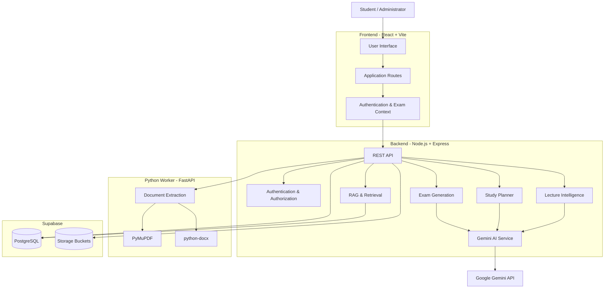

#  ExamForge
### AI-Powered Exam Generation, Intelligent Study Planning & Lecture Intelligence

**ExamForge** is an AI-powered academic platform designed to transform traditional exam preparation into an intelligent, personalized learning experience.

Students can upload their study materials, generate customized examinations, interact with an AI tutor, create personalized study schedules, and convert recorded lectures into organized learning resources.

By combining Large Language Models (LLMs), Retrieval-Augmented Generation (RAG), document processing, and intelligent scheduling, ExamForge brings multiple academic learning tools together in one platform.

---

##  Core Features

### 1.  AI Exam Generator

Generate customized examinations directly from uploaded study materials.

- Upload multiple PDF and DOCX documents.
- Extract text and organize content from study materials.
- Generate MCQs, short-answer, and long-answer questions.
- Customize question counts and difficulty levels.
- Distribute questions proportionally across uploaded documents using the Largest Remainder Method.
- Include answers, explanations, and marking criteria.
- Provide source-page references for generated questions.
- Interact with an AI tutor about individual exam questions.
- Copy and print generated examination papers.

### 2. AI Study Planner & Exam Scheduler

Create personalized study schedules based on your learning materials, syllabus, and examination dates.

- Upload multiple study documents.
- Enter topics manually or provide syllabus information.
- Analyze and map topics against uploaded resources.
- Identify missing topics and overlapping concepts.
- Organize topics according to difficulty and dependencies.
- Distribute study sessions according to available preparation time.
- Generate personalized daily study schedules.
- Manage multiple examinations, quizzes, midterms, and finals.
- Update task progress and intelligently reschedule unfinished tasks.
- Interact with an AI study assistant.

### 3. Daily Lecture Intelligence

Transform recorded lectures into structured and searchable learning resources.

- Upload audio and video lecture recordings.
- Analyze recorded lectures.
- Generate lecture summaries and organized notes.
- Extract important topics and subtopics.
- Identify definitions, formulas, examples, and concepts.
- Generate timestamp-linked lecture references.
- Ask questions about analyzed lectures using an AI tutor.
- Navigate to relevant moments in recordings.
- Convert analyzed lectures into examination practice sessions.

**Supported recording formats:** MP3, WAV, M4A, and MP4.

### 4.  AI-Powered RAG Tutoring

ExamForge uses Retrieval-Augmented Generation to provide context-aware responses based on learning materials.

- Extract and process document content.
- Divide documents into smaller chunks.
- Generate embeddings for semantic retrieval.
- Retrieve relevant information from stored document content.
- Provide contextual information to the AI model.
- Generate answers grounded in the retrieved study material.
- Support question-specific and lecture-based discussions.

### 5.  Authentication & Account Management

- Email and password authentication.
- Google OAuth 2.0 integration.
- JWT-based authentication.
- HTTP-only authentication cookies.
- Password hashing using bcrypt.
- Password recovery through email OTP verification.
- Protected application routes.
- User-specific document and examination management.

### 6.  Admin Control Panel

A dedicated administration interface accessible through `/boss`.

- Administrator authentication.
- User management and account controls.
- User activity and platform monitoring.
- Examination and document management.
- AI generation monitoring and error tracking.
- Model latency and usage monitoring.
- Storage management.
- Platform configuration and feature controls.

---

##  Technology Stack

| Layer | Technologies |
|---|---|
| Frontend | React 19, Vite 8 |
| Styling | Tailwind CSS v4 |
| Routing | React Router 7 |
| Icons | Lucide React |
| Backend | Node.js, Express 5 |
| AI Integration | Google Gemini API |
| AI Architecture | RAG, Semantic Search, Embeddings |
| Document Processing | Python, FastAPI |
| PDF Extraction | PyMuPDF |
| DOCX Extraction | python-docx |
| Database | Supabase PostgreSQL |
| File Storage | Supabase Storage |
| Authentication | JWT, bcryptjs, Google OAuth |
| Validation | Zod |
| Communication | REST APIs, HTTP-only Cookies, SSE where implemented |
| Email | Nodemailer |
| Performance Infrastructure | Redis integration |

---

## 🏗️ System Architecture

ExamForge follows a modular client-server architecture with a dedicated Python document-processing worker.



---

## 🔄 How ExamForge Works

### Document-Based Learning Workflow

1. **Upload:** Students upload PDF or DOCX study materials.
2. **Validation:** The backend validates incoming documents.
3. **Extraction:** The Python worker extracts document content.
4. **Processing:** Extracted text is organized into pages and chunks.
5. **Embedding:** Content is converted into embeddings for semantic retrieval.
6. **Storage:** Document information and processed content are stored in Supabase.
7. **Retrieval:** Relevant document chunks are retrieved when required.
8. **Generation:** Gemini generates contextual answers, examination questions, or study material.
9. **Learning:** Students interact with generated content and their AI tutor.

### AI Exam Generation Workflow

```text
Select Study Materials
        |
        v
Configure Examination
        |
        v
Extract & Analyze Content
        |
        v
Allocate Questions
        |
        v
Gemini AI Generation
        |
        v
Generate Answers & Explanations
        |
        v
Display Examination
        |
        v
Question Discussion & Learning
```

### Study Planning Workflow

```text
Upload Study Materials
        |
        v
Provide Topics & Exam Dates
        |
        v
Analyze Topics and Resources
        |
        v
Identify Gaps & Dependencies
        |
        v
Generate Personalized Schedule
        |
        v
Track Daily Progress
        |
        v
Smart Rescheduling
```

---

## 📁 Project Structure

```text
Exam-Fordge/
│
├── client/
│   ├── src/
│   │   ├── Admin-Dashboard/
│   │   ├── Context/
│   │   ├── Front-Page/
│   │   │   └── Auth/
│   │   ├── Lecture-Intelligence/
│   │   ├── Study-Planner/
│   │   ├── working-pages/
│   │   └── App.jsx
│   │
│   ├── package.json
│   └── vite.config.js
│
├── server/
│   ├── Api/
│   │   └── Index.js
│   │
│   ├── config/
│   ├── controller/
│   ├── middleware/
│   ├── routes/
│   ├── services/
│   │
│   └── package.json
│
├── python-worker/
│   ├── extractors/
│   │   ├── pdf.py
│   │   └── docx.py
│   │
│   ├── App.py
│   └── requirements.txt
│
├── supabase_migration.sql
├── .gitignore
└── README.md
```

---

## ⚙️ Installation & Setup

### Prerequisites

Install the following before running ExamForge:

- Node.js 20+
- Python 3.10+
- npm
- Git
- Supabase account
- Google Gemini API key

### 1. Clone the Repository

```bash
git clone https://github.com/itzMK678/Exam-Fordge.git

cd Exam-Fordge
```

### 2. Configure Environment Variables

Create `server/.env`:

```env
# Server
PORT=5000
CORS_ORIGIN=http://localhost:5173

# Supabase
SUPABASE_URL=your_supabase_project_url
SUPABASE_SERVICE_ROLE_KEY=your_supabase_service_role_key

# Gemini AI
GEMINI_API_KEY=your_gemini_api_key
GEMINI_GENERATION_MODEL=your_primary_model
GEMINI_FALLBACK_MODEL=your_fallback_model

# Embeddings
GEMINI_EMBEDDING_MODEL=your_embedding_model
GEMINI_EMBEDDING_DIMENSIONS=768

# Authentication & Encryption
JWT_SECRET=your_secure_jwt_secret
ENCRYPTION_SECRET=your_encryption_secret

# Python Worker
PYTHON_WORKER_URL=http://127.0.0.1:8000
INTERNAL_WORKER_SECRET=your_internal_worker_secret

# RAG Configuration
MAX_CHUNK_WORD_COUNT=500
CHUNK_OVERLAP=75
MAX_RAG_WORDS=35000

# AI Concurrency
MAX_CONCURRENT_GEMINI_REQUESTS=2

# Optional Redis
REDIS_URL=your_redis_connection_url

# Optional Email Configuration
GMAIL_USER=your_email@gmail.com
GMAIL_APP_PASSWORD=your_google_app_password

# Optional Google OAuth
GOOGLE_CLIENT_ID=your_google_client_id
GOOGLE_CLIENT_SECRET=your_google_client_secret
```

Use the model names supported by your configured Gemini API account.

Create a frontend environment file if required by your deployment:

`client/.env`

```env
VITE_API_URL=http://localhost:5000
```

Never place private API keys, service-role credentials, JWT secrets, or encryption secrets in frontend environment variables.

### 3. Database Setup

ExamForge uses Supabase PostgreSQL.

1. Create a Supabase project.
2. Open the Supabase SQL Editor.
3. Open `supabase_migration.sql` from the project root.
4. Execute the migration.
5. Verify the required database tables, indexes, RLS policies, and storage buckets.

The migration includes database structures for:

- Users
- Documents
- Document pages
- Document chunks
- Exam sessions
- Question discussions
- Lectures
- Lecture chats
- Storage buckets and access policies

### 4. Start Python Worker

Open a terminal:

```bash
cd python-worker

python -m venv venv
```

Activate the environment.

**Windows:**

```bash
venv\Scripts\activate
```

**Linux / macOS:**

```bash
source venv/bin/activate
```

Install dependencies:

```bash
pip install -r requirements.txt
```

Start the worker:

```bash
uvicorn App:app --host 127.0.0.1 --port 8000 --reload
```

Worker URL:

```text
http://127.0.0.1:8000
```

### 5. Start Backend Server

Open another terminal:

```bash
cd server

npm install

npm run dev
```

Backend URL:

```text
http://localhost:5000
```

### 6. Start Frontend

Open a third terminal:

```bash
cd client

npm install

npm run dev
```

Frontend URL:

```text
http://localhost:5173
```

---

## 🔑 Important API Routes

The backend organizes functionality into separate route modules.

| Route | Purpose |
|---|---|
| `/api/auth` | Registration, login, authentication and account recovery |
| `/api/health` | Backend health checks |
| `/api/documents` | Document processing and management |
| `/api/exams` | Exam generation and question discussions |
| `/api/history` | Exam history |
| `/api/lectures` | Lecture intelligence |
| `/api/study-planner` | Study planning and scheduling |
| `/api/admin` | Administration |
| `/api/work` | Work-related functionality |

Protected endpoints require the appropriate authentication and authorization.

---

## 🔐 Security Considerations

ExamForge uses several security-related mechanisms:

- HTTP-only authentication cookies.
- JWT-based authentication.
- Password hashing with bcrypt.
- Authentication middleware.
- Rate limiting for authentication and exam generation.
- Input validation with Zod.
- Configurable CORS policies.
- Supabase Row Level Security.
- Private Supabase Storage buckets.
- Server-side environment variables.
- Internal worker authentication through a shared secret when configured.

**Security reminder:** Keep all private credentials outside the frontend and never commit `.env` files to GitHub.

---

## 🚀 Future Development

ExamForge is designed to evolve into a comprehensive intelligent learning platform.

Potential areas of further development include:

- More advanced RAG retrieval and contextual understanding.
- Improved AI model routing and automatic failover.
- Collaborative learning and group discussions.
- Interactive knowledge-based games.
- Advanced learning analytics.
- More personalized AI learning recommendations.
- Further optimization of document processing and AI generation.

---

## 🎯 Project Vision

Traditional exam preparation often requires students to spend hours organizing study materials, identifying important topics, creating practice questions, and planning their preparation.

ExamForge brings these activities together through intelligent automation.

It aims to help students:

- Understand difficult concepts.
- Generate practice examinations.
- Organize study materials.
- Build effective preparation schedules.
- Learn from recorded lectures.
- Interact with AI-powered tutors.

**Learn Smarter. Practice Better. Prepare with ExamForge.**

---

## 👨‍💻 Developer

**Mamoon Khaliq**

Full Stack & AI Engineer

- GitHub: [@itzMK678](https://github.com/itzMK678)
- Portfolio: [mamoondev.vercel.app](https://mamoondev.vercel.app)

---

⭐ If you find ExamForge interesting, consider giving the repository a star!
